**autistic about customization.** I'm not much of a coder, but with prompt engineering and programming logic
I keep building my projects: a whole Arch Linux desktop shaped to my taste, widgets, themes, and ASCII art.

ASCII generated from a public-domain photo of the Venus de Milo (Louvre, Wikimedia Commons) &middot; source in <code>scripts/</code>

